# Activity 1: My First Nuxt Application (Frontend)

**Name:** Elaine Mae M. Balbada  
**Course and Section:** ITE 18 - AIEM1

---

## Project Overview

This project is a personal portfolio website developed using **Nuxt.js, Vue.js, TypeScript, and Tailwind CSS**.

It showcases my personal information, educational background, technical skills, areas of interest, and hobbies through a two-page website.

The website features a modern editorial design with a muted rose and burgundy color palette, interactive elements, and smooth visual animations.

## Features

### 1. Homepage
- Personal introduction and profile picture
- Welcome message
- Navigation menu
- Introduction to the profile page
- Navigation links to other sections

### 2. Profile Page
- Personal information
- Educational background
- Technical skills and technologies
- Areas of interest
- Hobbies and personal interests
- Knowledge-sharing activities

### 3. Navigation and Layout
- Reusable navigation component
- Navigation links between the homepage and profile page
- Shared default layout
- Consistent design across pages
- Responsive page layout

### 4. Visual Effects and Interactions
- **Scroll Reveal Animation** – Content sections gradually appear as they enter the viewport.
- **Smooth Hover Transitions** – Cards and interactive elements transition smoothly when hovered over.
- **Interactive Cards** – Cards respond to cursor interactions with subtle movement effects.
- **Smooth Scrolling** – Provides smoother navigation through page sections.
- **Responsive Design** – Layout adapts to different screen sizes.

## Technologies Used

| Technology | Purpose |
|---|---|
| Nuxt.js | Application framework |
| Vue.js | Component-based frontend development |
| TypeScript | Type-safe JavaScript development |
| Tailwind CSS | Utility-first styling |
| HTML | Website structure |
| CSS | Custom styling and visual effects |

## Screenshots

### 1. Homepage

The homepage introduces the website through a personal introduction, welcome message, and profile overview.

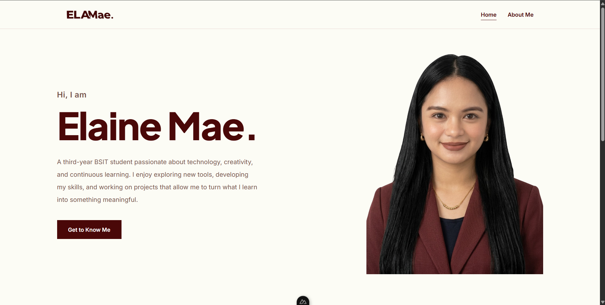

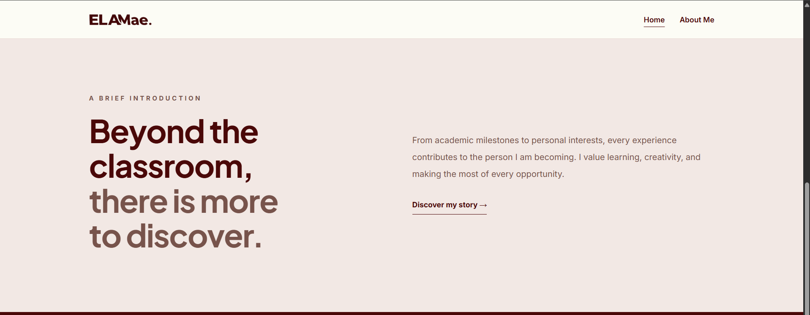

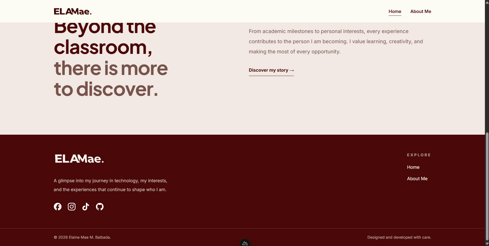

### 2. Profile Page

The profile page presents my personal background, educational journey, technical skills, areas of interest, hobbies, and knowledge-sharing activities.

**About Me**

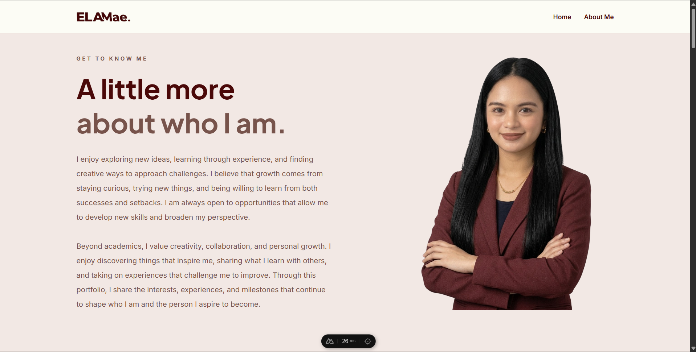

**Personal Information**

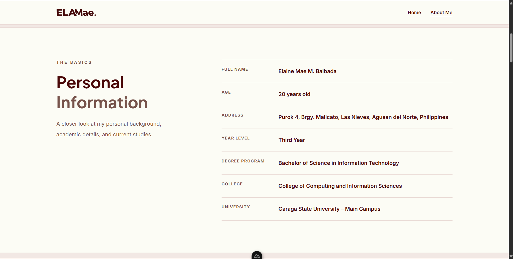

**Educational Background**

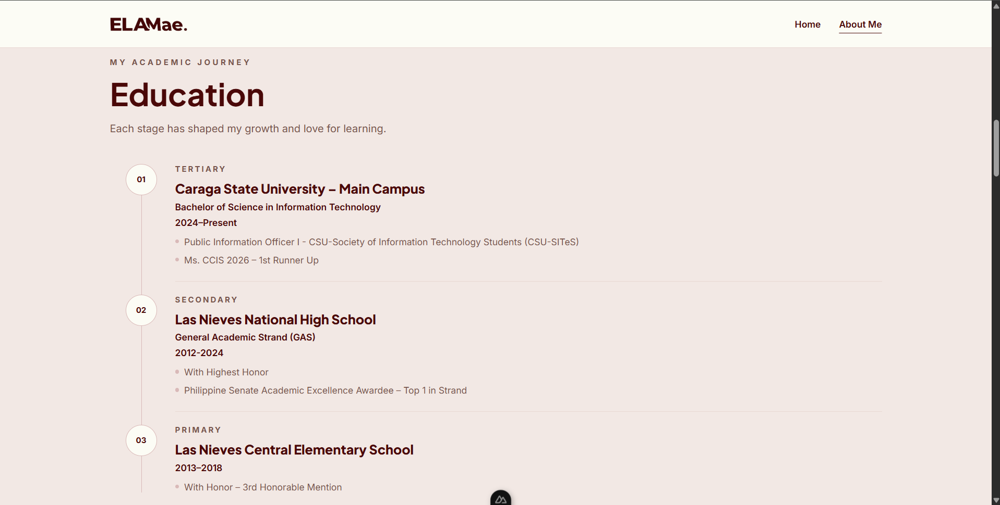

**Technical Skills**

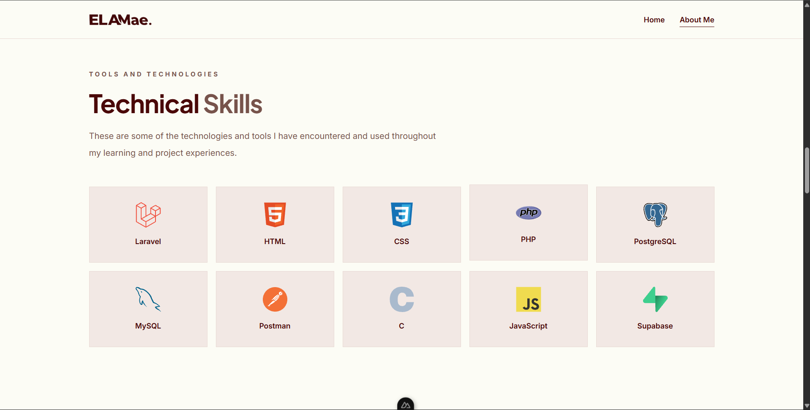

**Areas of Interest**

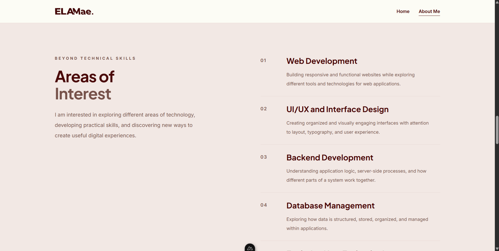

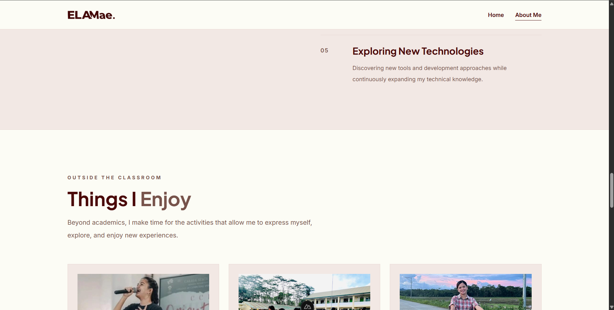

**Things I Enjoy**

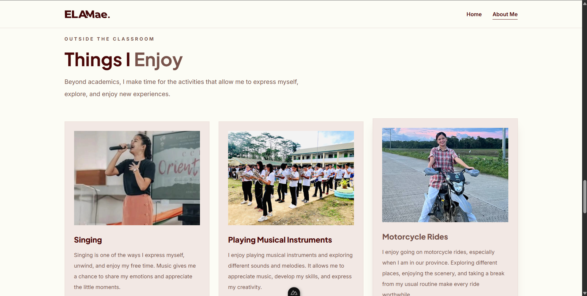

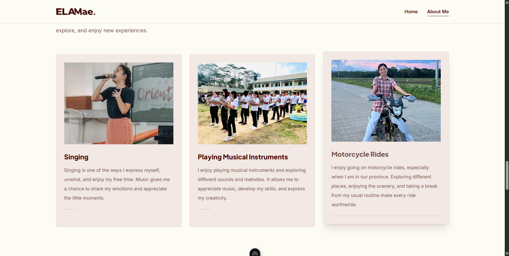

**Knowledge Sharing**

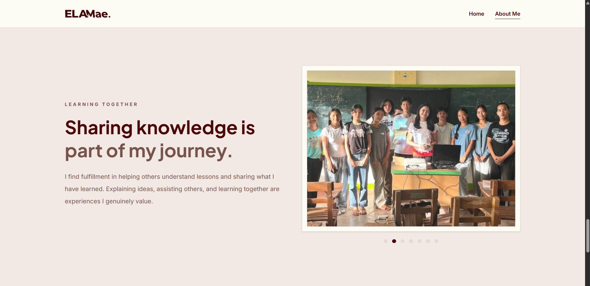

**Closing Section**

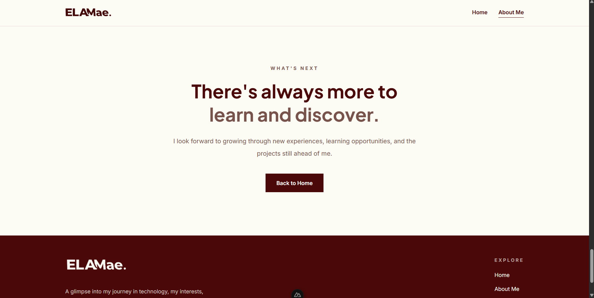

### 3. Website Footer

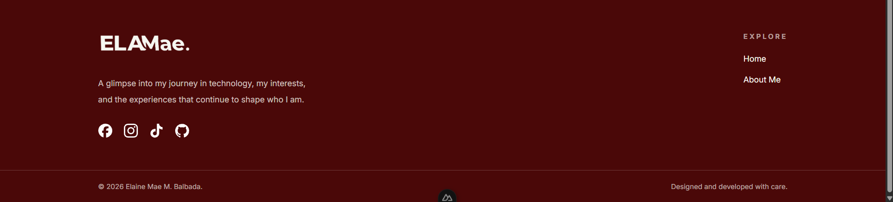

### 4. Project Structure

The following screenshots show the actual folder and file organization of the Nuxt project.

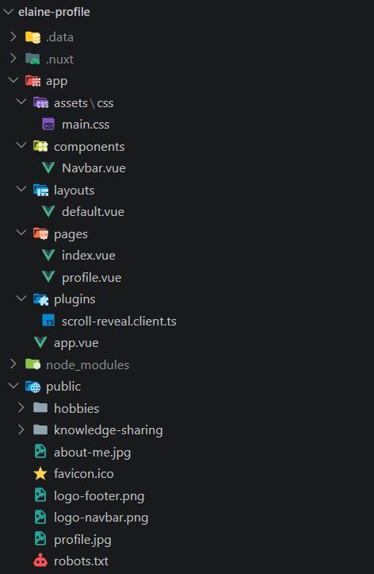

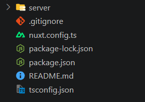

## Installation and Setup

### Prerequisites
- Node.js
- npm

### 1. Clone the Repository

```bash
git clone https://github.com/elainemaebalbada/elaine-portfolio-nuxtjs-act1.git
```

### 2. Navigate to the Project Directory

```bash
cd elaine-portfolio-nuxtjs-act1
```

### 3. Install Dependencies

```bash
npm install
```

### 4. Run the Development Server

```bash
npm run dev
```

Open the local development URL displayed in the terminal, usually:

```text
http://localhost:3000
```

## Activity Requirements

| Requirement | Implementation |
|---|---|
| Create a Nuxt application | Nuxt project initialized |
| Explore project folders | Explored pages, components, layouts, and public |
| Create a homepage | `app/pages/index.vue` |
| Create a personal profile page | `app/pages/profile.vue` |
| Add navigation links | `app/components/Navbar.vue` |
| Apply Tailwind CSS styling | Applied throughout the website |
| Include personal information | Added to the profile page |
| Include educational background | Added to the profile page |
| Include skills and interests | Added to the profile page |
| Include hobbies | Added to the profile page |

## Repository

[View My GitHub Repository](https://github.com/elainemaebalbada/elaine-portfolio-nuxtjs-act1)

## Author

**Elaine Mae M. Balbada**  
BSIT – ITE 18 - AIEM1  
Caraga State University – Main Campus
